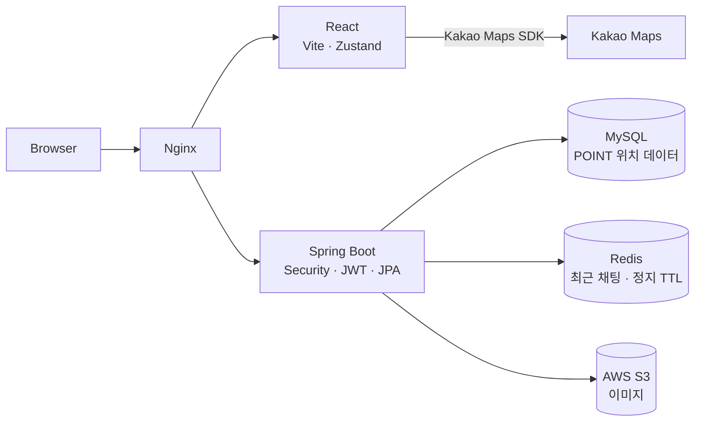
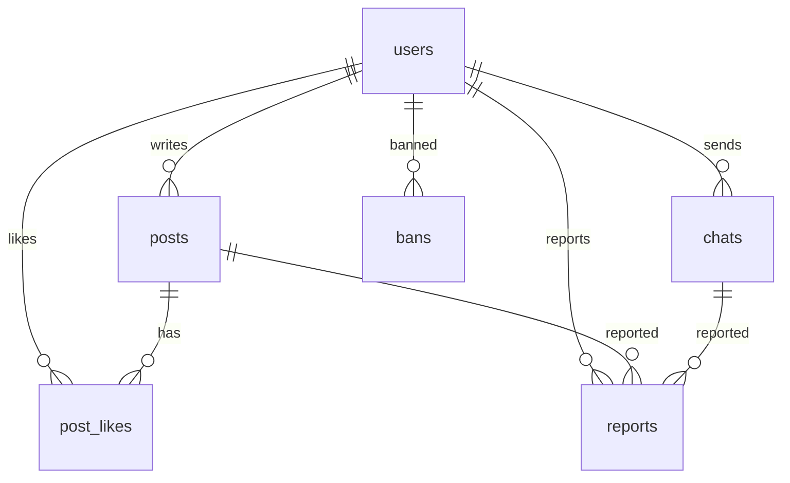
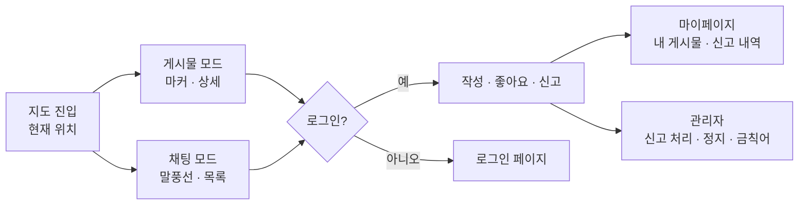

# 📍 LinkUs — 지도 위에서 발견하고, 대화하는 지역 커뮤니티

> 현재 위치를 탐색의 시작점으로 삼아 **지도 게시물**과 **위치 기반 실시간 채팅**을 한 화면에서 연결하는 지도 기반 커뮤니티 서비스

| 항목 | 내용 |
|---|---|
| 기간 | 2026.06.08 ~ 2026.07.02 (4주) |
| 소속 | 휴먼AI교육센터 · AI·빅데이터 웹솔루션 개발자 양성 과정 중간 프로젝트 |
| 인원 | 4명 (Front 2 · Back 1 · Lead 1) |
| 내 역할 | **Frontend** (인증·마이페이지·신고·관리자) + 관리·제재 백엔드 |
| 원본 레포 | [JephyrWing/project_linkus](https://github.com/JephyrWing/project_linkus) |

> 팀 프로젝트 원본을 포크한 레포입니다. 전체 구조를 함께 설명하되, **내 담당 항목은 ✅로 표시**했습니다.

## 목차

| # | 구분 | 내용 |
|---|---|---|
| 01 | 프로젝트 개요 | 기획 배경·문제 정의 · 기존 SNS와 차별점 · 서비스 컨셉 · 목표와 기대효과 |
| 02 | 시스템 개요 | 요구사항 명세 · 기술 스택 · 인증 · 아키텍처 · API 설계 · DB 구조 |
| 03 | 서비스 구현 | 서비스 구조 · 핵심 기능 흐름 · 화면별 구현 |
| 04 | 검증 | 기능 검증 · 비기능 요구사항 반영 |
| 05 | 발전방향 및 회고 | 개발 성과 · 트러블슈팅 · 개선 방향 · 배운 점 |

## 팀 구성

| 이름 | 역할 |
|---|---|
| 최진우 | Lead |
| **김수현** | **Frontend** (인증·마이페이지·신고·관리자) · 관리·제재 백엔드 |
| 백가연 | Frontend · 기획 · UX |
| 김창진 | Backend |

---

# 01. 프로젝트 개요

## 1.1 기획 배경과 문제 정의

| 문제 | 설명 |
|---|---|
| Q1 장소의 '지금'이 묻힘 | 피드형 SNS에서는 장소가 게시물의 부가 정보가 되기 쉽다 |
| Q2 반복 탐색 | 내 주변 상황을 보려면 검색·이동·상세 진입을 반복해야 한다 |
| Q3 가입 장벽 | 처음 방문한 사용자는 가입 요구 때문에 둘러보기 전에 이탈한다 |
| Q4 운영 부담 | 위치 기반 익명 커뮤니티는 악성 이용자·부적절한 게시물 관리가 어렵다 |

## 1.2 기존 피드형 SNS와 LinkUs의 차별점

| 구분 | 피드형 SNS | LinkUs |
|---|---|---|
| 기본 화면 | 시간순 피드 | **지도** |
| 장소 정보 | 게시물의 태그·부가 정보 | 게시물·채팅의 **위치 자체가 탐색 기준** |
| 실시간 소통 | 별도 메신저·댓글 | 지도 위 **말풍선 채팅** |
| 비회원 | 열람 제한 | **둘러보기 허용**, 작성 시점에 로그인 |
| 안전 장치 | 신고 중심 | 신고 + **금칙어 필터 + 회원 정지 + 재가입 방지** |

## 1.3 서비스 컨셉과 운영 원칙

| 원칙 | 내용 |
|---|---|
| 01 지도가 기본 인터페이스 | 게시물과 실시간 채팅을 현재 위치·지도 말풍선·목록에 동시에 반영 |
| 02 낮은 진입 장벽 | 비회원도 탐색 가능, 글·채팅·좋아요·신고 등 첫 생성 행동에서 인증 요구 |
| 03 안전한 커뮤니티 | 신고·금칙어·제재·관리자 기능을 부가 기능이 아닌 핵심 흐름으로 포함 |

## 1.4 목표와 기대효과

| 목표 | 기대효과 |
|---|---|
| 위치 맥락 유지 | 내 주변의 게시물과 대화를 한눈에 파악 |
| 참여 유도 | 탐색 후 자연스럽게 작성·채팅으로 이어지는 흐름 |
| 신뢰 확보 | 악성 이용자 제재와 부적절한 표현 차단으로 안전한 이용 환경 |

> 기대효과는 검증할 가설이며, 실사용자 지표는 측정하지 않았습니다.

---

# 02. 시스템 개요

## 2.1 요구사항 명세

요구사항 정의서 기준 **10개 시스템 영역 · 59개 요구사항**을 Route · DB · HTTP Method · API Path와 연결해 관리했습니다.

| 시스템 | 요구사항 수 |
|---|---|
| 사이드바 | 14 |
| 마이페이지 | 9 |
| 맵 게시물 | 7 |
| 관리자 | 7 |
| 회원가입 | 5 |
| 로그인 | 5 |
| ETC (하단 페이지) | 5 |
| 실시간 채팅 | 4 |
| 신고 | 2 |
| 화면 전환 | 1 |

### 기능 요구사항 (FR)

| ID | 영역 | 완료 기준 | Route | 상태 | 담당 |
|---|---|---|---|---|---|
| FR-01 | 실시간 채팅 | 채팅 작성, 지도 위 말풍선 표시, 현재 위치 이동 | `/livechat` | 구현 | 팀 · ✅ UX 개선 |
| FR-02 | 맵 게시물 | 작성·주변 게시물 조회·좋아요·인기 게시물·로드뷰 | `/mappost` | 구현 | 팀 |
| FR-03 | 화면 전환 | 실시간 채팅 ↔ 맵 화면 전환 | — | 구현 | 팀 |
| FR-04 | 회원가입 | 일반·구글·카카오 가입, 아이디·닉네임 중복 확인 | `/signup` | 구현 | ✅ |
| FR-05 | 로그인 | 일반·구글·카카오 로그인, 소셜 로그인 콜백 | `/login` | 구현 | ✅ |
| FR-06 | 마이페이지 | 내 정보 조회·수정, 탈퇴, 내 게시물·좋아요한 글, 지도 위치로 이동 | `/mypage` | 구현 | ✅ |
| FR-07 | 신고 | 게시글·채팅 신고, 신고 목록·수정·삭제 | `/report` | 구현 | ✅ |
| FR-08 | 관리자 | 회원 목록·상세, 금칙어 관리, 신고 관리, 전체 게시물·채팅 조회·삭제, 회원 정지 | `/adminpage` | 구현 | ✅ |
| FR-09 | 사이드바 | 비회원·회원·관리자 상태별 메뉴, 로그아웃 | — | 구현 | ✅ |
| FR-10 | 하단 페이지 | 서비스 소개·이용약관·개인정보 처리방침·신고 가이드 | — | 구현 | 팀 |

### 비기능 요구사항 (NFR)

> 요구사항 정의서에는 기능 요구사항만 있어, 구현과 기능별 순서도를 기준으로 정리했습니다.

| ID | 영역 | 기준 | 구현 방식 | 담당 |
|---|---|---|---|---|
| NFR-01 | 인증 | 로그인 사용자만 생성 행동 가능 | Spring Security + JWT, 비로그인 시 로그인 페이지로 이동 | 팀 · ✅ 화면 |
| NFR-02 | 권한 | 관리자 기능 분리 | `ROLE_ADMIN` 확인, 관리자만 관리자 메뉴 노출 | ✅ |
| NFR-03 | 콘텐츠 보호 | 부적절한 표현 차단 | 채팅 작성 시 금칙어 검사 → `***`로 대체 | 팀 · ✅ 금칙어 관리 |
| NFR-04 | 제재 | 정지 기간 동안 활동 제한 | Redis TTL로 정지 기간 관리, 정지 회원 게시글 작성 차단 | ✅ |
| NFR-05 | 제재 우회 방지 | 탈퇴 후 재가입으로 제재 회피 불가 | 정지 이메일 기록, 가입 시 확인 | ✅ |
| NFR-06 | 추적성 | 신고 대응을 위한 기록 유지 | 비로그인 채팅은 IP 저장, 탈퇴 후에도 채팅 IP·내용 유지 | 팀 · ✅ 탈퇴 정책 |
| NFR-07 | 개인정보 | 로그아웃·탈퇴 후 정보 잔존 방지 | 토큰·localStorage 정리 | ✅ |
| NFR-08 | 성능 | 지도 조회 부하 감소 | 지도 이동 300ms 디바운스, 화면 영역(Bounds) 내 게시물만 조회 | 팀 |
| NFR-09 | 실시간성 | 최근 채팅 빠른 조회 | 반경 5km 내 작성 1분 미만 채팅을 Redis에서 조회 | 팀 |
| NFR-10 | 대용량 처리 | 목록 성능 | 내 게시물·신고 내역·채팅·관리자 목록 페이징 | ✅ |
| NFR-11 | 이미지 | 업로드 최적화 | 사진 크기·형식 최적화 후 S3 업로드 | 팀 |
| NFR-12 | 배포 | 자동 배포 | GitHub Actions · DockerHub · EC2 Docker Compose | 팀 |

## 2.2 기술 스택

| 영역 | 기술 | 역할 |
|---|---|---|
| Frontend | React 19 · Vite · React Router · React Bootstrap | 화면, 라우팅 |
| 상태·통신 | Zustand · Axios | 로그인 상태 관리, API 요청 |
| 지도 | Kakao Maps SDK | 지도·마커·로드뷰 |
| Backend | Java 17 · Spring Boot 3.5 · Spring Data JPA · Hibernate Spatial | REST API, 위치 데이터 처리 |
| 인증 | Spring Security · JWT · Kakao·Google OAuth | 인증·권한 |
| DB | MySQL (`POINT` 위치 타입) · Redis | 영구 데이터, 최근 채팅·정지 TTL |
| Storage | AWS S3 | 게시물 이미지 |
| Infra | AWS EC2 · Docker · Nginx · GitHub Actions | 배포 |
| 협업 | GitHub · Slack · Google Drive · Miri Canvas | 협업·디자인 |

## 2.3 인증과 권한

| 사용자 상태 | 가능한 기능 | 사이드바 메뉴 |
|---|---|---|
| 비회원 | 지도·게시물·채팅 열람 | Home · Login · Sign Up |
| 회원 | + 작성·좋아요·신고·마이페이지 | 내 프로필 · Home · 마이페이지 · 신고 · 로그아웃 |
| 관리자 (`ROLE_ADMIN`) | + 관리자 기능 | 위 메뉴 + **관리자 페이지** |
| 정지 회원 | 열람만 가능, 작성 시 사유와 함께 경고 | — |

## 2.4 시스템 아키텍처

| 계층 | 역할 |
|---|---|
| Nginx | 요청을 React 정적 파일과 Spring API로 분리 |
| React | 지도 화면, 게시물·채팅 UI, 인증·마이페이지·관리자 화면 |
| Spring Boot | REST API, JWT 인증, 금칙어 검사, 신고·제재 로직 |
| MySQL | 회원·게시물·채팅·신고·제재·금칙어 영구 저장 |
| Redis | 최근 채팅 조회, 회원 정지 기간(TTL) |
| AWS S3 | 게시물 이미지 |

## 2.5 API 설계

| 도메인 | Base Path | 대표 엔드포인트 | 담당 |
|---|---|---|---|
| 회원 | `/api/users` | `POST signup` · `login` · `oauth/kakao` · `oauth/google` · `GET signup/idconfirm/{id}` · `signup/emailconfirm/{email}` | ✅ 소셜 |
| 내 정보 | `/api/users` | `GET·PUT·DELETE my/{userId}` · `GET info/{userId}` | ✅ 화면 |
| 게시물 | `/api/posts` | `POST upload` · 주변 조회 · `GET {postId}` · `DELETE posts/{postId}` · `POST·DELETE postlikes` | 팀 |
| 채팅 | `/api/chats` | 작성 · 조회 · `GET chats/author/{chatId}` | 팀 |
| 신고 | `/api/reports` | 작성 · `GET reports/findall` · `reports/posts` · `reports/chats` · `reports/processed` · `reports/unprocessed` · `PUT reports/{id}` · `DELETE {id}` | ✅ |
| 관리자 | `/api/admin` | `GET users/findall` · `posts/findall` · `chats/findall` · `admin/author-info/{chatId}` · `DELETE chats/{chatId}` | ✅ |
| 회원 정지 | `/api/admin/bans` | 정지 · 해제 · 조회 | ✅ |
| 금칙어 | `/api/admin/filters` | 추가 · 삭제 · 조회 | ✅ |

## 2.6 DB 구조

| 테이블 | 주요 컬럼 | 용도 | 담당 |
|---|---|---|---|
| `users` | user_id · email · password · nick_name · role · gender · kakao/google_account_link · chat_custom | 회원, 소셜 연동, 꾸미기 설정 | 팀 |
| `posts` | text · image_url · location(`POINT`) · altitude · like_num · marker_custom · box_custom | 지도 게시물 | 팀 |
| `post_likes` | users_id · posts_id | 좋아요 | 팀 |
| `chats` | text · location(`POINT`) · ip · users_id | 위치 기반 채팅 | 팀 |
| `reports` | text · processed · posts_id · chats_id · users_id | 게시글·채팅 신고 | ✅ |
| `bans` | users_id · reason · ip · ttl · banned_email | 회원 정지, 재가입 방지 | ✅ |
| `filters` | word | 금칙어 | ✅ 관리 |

---

# 03. 서비스 구현

## 3.1 서비스 구조

## 3.2 핵심 기능 흐름

### ① 실시간 채팅

| 순서 | 처리 |
|---|---|
| 1 | 채팅 지도 진입, 현재 위치 확인 |
| 2 | 반경 5km 내 작성 1분 미만 채팅을 Redis에서 조회 → 지도 말풍선 표시 |
| 3 | 채팅 입력 → 금칙어 검사 (포함 시 `***`로 대체) |
| 4 | 로그인 사용자는 userId, 비로그인 사용자는 IP 정보 포함 |
| 5 | MySQL 저장 → chatId 기준 Redis 저장 → 채팅 목록 갱신 |

### ② 맵 게시물

| 순서 | 처리 |
|---|---|
| 1 | 지도 idle 후 현재 화면 영역(Bounds) 계산 → 영역 안 게시물 조회 |
| 2 | 지도 이동 시 300ms 디바운스 후 재조회 |
| 3 | 마커 클릭 → 간단 카드 → 상세보기 (본문·사진·좋아요) |
| 4 | 작성자: 수정·삭제 / 다른 사용자: 좋아요·신고 / 비로그인: 조회만 |
| 5 | 작성 시 사진 최적화 → S3 업로드 → 좌표 DB 저장 → 마커 갱신 |

### ③ 좋아요·신고·마이페이지 ✅

| 기능 | 처리 |
|---|---|
| 좋아요 | 로그인 확인 → 추가·취소 → 좋아요 수 갱신 |
| 신고 | 로그인 확인 → 본인 게시물은 신고 불가 → 신고 내용 작성·저장 |
| 마이페이지 | 회원 정보 조회·수정, 내 게시물, 좋아요한 게시물, 내 신고 내역 → 지도 보기로 해당 위치 이동 |

### ④ 관리자 ✅

| 기능 | 처리 |
|---|---|
| 접근 | 관리자 로그인 → `ROLE_ADMIN` 확인 → 관리자 페이지 |
| 회원 관리 | 전체 회원 조회, 회원 상세(작성 게시글·채팅), 정지·해제, 정지 회원 분리 |
| 신고 관리 | 신고 목록·상세, 신고 대상 회원 상세로 이동, 처리·미처리 구분 |
| 콘텐츠 관리 | 전체 게시물·채팅 조회, 강제 삭제 |
| 금칙어 관리 | 금칙어 추가·삭제, 페이징 |

## 3.3 화면별 구현 (내 담당) ✅

| 화면 | 구현 내용 |
|---|---|
| 로그인 | 로그인 API 연결, 엔터키 로그인, 실패 시 경고창 |
| 회원가입 | 로그인·회원가입 분리, 중복 확인 연결 |
| 소셜 로그인 | 카카오·구글 버튼 및 소셜 회원가입 흐름, 소셜 회원은 비밀번호 없이 정보 수정 |
| 사이드바 | 로그인 상태별 메뉴, 로그인 사용자 ID 표시, 관리자 메뉴 노출 |
| 로그아웃·탈퇴 | 확인창, 토큰·localStorage 정리 |
| 마이페이지 | 회원정보 조회·수정, 내 게시물, 내 신고 내역, 페이징 |
| 신고 | 게시글 상세·채팅창 신고 버튼, 신고 작성·수정·삭제, 비로그인 시 로그인 페이지 이동 |
| 관리자 | 회원·게시글·채팅·신고·금칙어 관리, 게시글 상세, 회원 정지 |
| 채팅 UX | 자동 스크롤, 채팅 페이징, 지도 말풍선 줄바꿈, 신고 아이콘 |

## 3.4 관리·제재 백엔드 (내 담당) ✅

| 기능 | 구현 내용 |
|---|---|
| 신고 | 신고 엔티티·API, 게시글/채팅별·처리 상태별 조회 |
| 회원 정지 | MySQL에 정지 기록, **Redis TTL**로 정지 기간 관리 |
| 재가입 방지 | 정지 회원 이메일 기록, 탈퇴 후 재가입 차단 |
| 작성 제한 | 정지 회원 게시글 작성 차단, 사유와 함께 경고 |
| 회원 탈퇴 | 게시글만 남기고 개인정보 삭제, 채팅 IP·내용은 운영 목적으로 유지 |
| 관리자 API | 회원·게시글·채팅 조회·삭제, 작성자 정보 조회, 금칙어 관리 |
| 소셜 로그인 | 카카오·구글 OAuth 서비스 연동 |

---

# 04. 검증

## 4.1 기능 검증

내 담당 기능은 시나리오별로 직접 실행해 확인했습니다 (수동 검증).

| 시나리오 | 확인 내용 | 결과 |
|---|---|---|
| 비회원 탐색 → 로그인 유도 | 비로그인 상태에서 작성·신고 시 로그인 페이지로 이동 | 확인 |
| 회원가입 → 로그인 → 마이페이지 | 가입·로그인·정보 수정·내 게시물 조회 | 확인 |
| 게시물·채팅 신고 → 관리자 처리 | 신고 작성 → 관리자 신고 목록 → 처리·삭제 | 확인 |
| 회원 정지 → 작성 제한 | 정지 회원 게시글 작성 시 경고 | 확인 |
| 정지 회원 탈퇴 → 재가입 | 같은 이메일 재가입 차단 | 확인 |
| 로그아웃·탈퇴 | 토큰·localStorage 정리, 이전 사용자 정보 미노출 | 확인 |

> 팀 전체로는 5개 E2E 시나리오와 프론트 production build를 검증했습니다. 자동화 테스트 코드는 작성하지 않았습니다.

## 4.2 비기능 요구사항 반영

| ID | 영역 | 결과 |
|---|---|---|
| NFR-01~02 | 인증·권한 | 반영 |
| NFR-03~06 | 콘텐츠 보호·제재·추적성 | 반영 |
| NFR-07 | 개인정보 잔존 방지 | 반영 |
| NFR-08~11 | 성능·실시간성·이미지 | 반영 |
| — | 부하·가용성 | 미실시 |

---

# 05. 발전방향 및 회고

## 5.1 개발 성과 (내 담당) ✅

| 영역 | 성과 |
|---|---|
| 인증 화면 | 일반·소셜 로그인·회원가입, 상태별 사이드바 |
| 마이페이지 | 정보 수정, 내 게시물·신고 내역, 탈퇴 |
| 신고 | 게시글·채팅 신고 전체 흐름 |
| 관리자 | 회원·게시글·채팅·신고·금칙어 관리 화면과 API |
| 제재 | Redis TTL 정지, 재가입 방지, 작성 제한 |

## 5.2 트러블슈팅

### ① 정지 회원이 탈퇴 후 재가입해 제재를 우회하는 문제

| 구분 | 내용 |
|---|---|
| 문제 | 정지된 회원이 탈퇴하면 회원 데이터와 함께 정지 기록도 사라져, **같은 이메일로 다시 가입** 가능 |
| 해결 | 정지 엔티티에 `bannedEmail`을 추가해 탈퇴 후에도 정지 이력 유지 → 가입 시 확인 |
| 보완 | 정지 회원은 게시글 작성 시 사유와 함께 경고, 탈퇴 시에도 신고 대응을 위해 채팅 IP·내용 유지 |

### ② 로그아웃·탈퇴 후 이전 사용자 정보가 남는 문제

| 구분 | 내용 |
|---|---|
| 문제 | 로그아웃·탈퇴 후에도 브라우저에 사용자 정보와 꾸미기 설정이 남아 다음 사용자 화면에 노출 |
| 해결 | 로그아웃·탈퇴 시 토큰과 localStorage 항목을 함께 정리 |

### ③ 요청마다 사용자 ID를 직접 전달해야 하는 구조 (→ 다음 프로젝트에서 개선)

| 구분 | 내용 |
|---|---|
| 경험 | 마이페이지·신고 등 기능마다 프론트에서 사용자 ID를 관리하고 요청에 담아 보내야 했음 |
| 느낀 점 | 기능이 늘수록 같은 처리가 반복되고 검증 누락 위험이 생김 |
| 이후 | 다음 프로젝트 **[Mindot](https://github.com/dkfjalsj/project_mindot)** 에서 백엔드를 맡아, JWT 인증 컨텍스트에서 사용자 ID를 주입받는 구조(`@AuthenticationPrincipal`)로 개선 |

## 5.3 개선 방향

| 구분 | 내용 |
|---|---|
| 사용자 식별 | 요청의 userId 대신 인증 컨텍스트 기반으로 전환 (Mindot에서 적용) |
| 테스트 | E2E 자동화, 회귀 테스트 코드 작성 |
| 운영 | 이벤트 로깅, 오류 복구 방식 표준화 |
| 지표 | 활성 사용자·작성 전환·리텐션 측정 |

## 5.4 배운 점

| 키워드 | 내용 |
|---|---|
| 운영 관점 | 기능 구현만큼 신고·제재·탈퇴처럼 "서비스를 지키는 기능"이 중요하다 |
| 상태 관리 | 로그인 상태에 따라 화면·메뉴·권한이 달라지는 흐름을 일관되게 관리하는 법 |
| 프론트-백 협업 | API 응답 형태가 화면 구현에 미치는 영향을 체감 → 다음 프로젝트에서 백엔드를 맡을 때 요구사항을 먼저 정리하는 습관으로 이어짐 |
